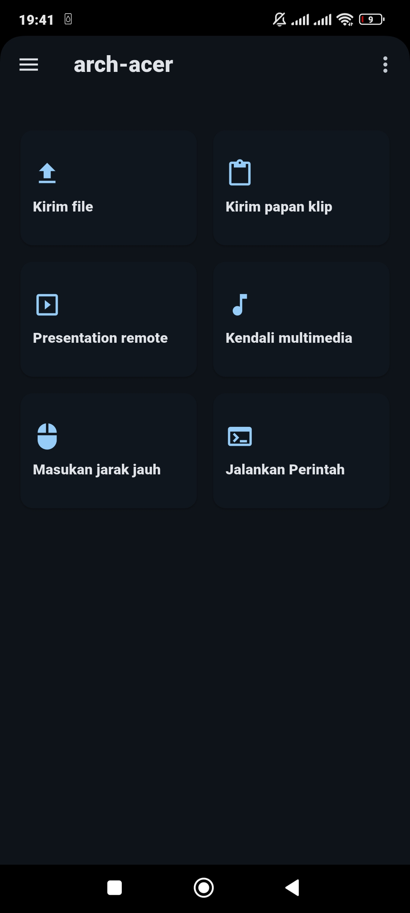
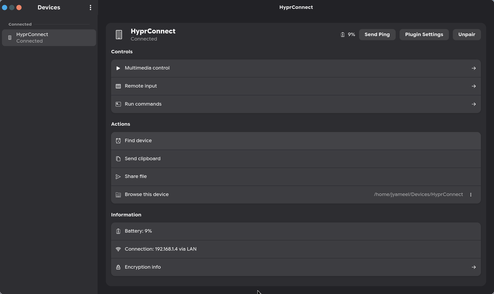

<p align="center">
  
</p>

# HyprConnect

Compact KDE Connect-compatible companion for Hyprland, written in Rust.

HyprConnect implements a subset of the KDE Connect protocol in a single
lightweight daemon, paired with a GTK 4 desktop app and its own Android
app. It also pairs with the official KDE Connect Android app, and
deliberately leaves out everything that is not needed day to day,
without pulling in any KDE or Qt stack.

## Screenshots

| Mobile | Desktop |
| --- | --- |
|  |  |

## Install

Download `hyprconnect-linux-x86_64.tar.gz` from the
[latest release](https://github.com/ShrlJamil/hyprconnect/releases/latest),
unpack it and run the installer. It copies the daemon and the desktop
app into `~/.local/bin`, installs the systemd user unit, the desktop
entry and the icon, and starts the daemon:

```sh
tar -xzf hyprconnect-linux-x86_64.tar.gz
cd hyprconnect
./install.sh
```

The Android app is the `app-release.apk` asset in the same release.

## Status

Current release is v1.0.0+12. The daemon, the desktop app and the
Android app are implemented and in daily use. Discovery, TLS transport
and pairing, clipboard sync, file sharing in both directions,
notification mirroring, MPRIS control in both directions, SFTP browsing
of the phone storage, the presentation remote, remote input and run
commands all work against the companion Android app, and the core
features are verified against the official KDE Connect Android app on
a real phone.

## Features

- File sharing, send and receive
- Clipboard sharing between phone and desktop
- Notification sharing from phone to desktop
- MPRIS sharing, control desktop players from the phone and the other way round
- SFTP mount of the phone storage for any file manager
- Presentation remote with a laser pointer overlay, carried over from HyprPresenter
- Remote input, touchpad and keyboard from the phone
- Run commands on the desktop from the phone
- Find device, battery status and in-app updates

## Not planned

SMS and telephony are out of scope by design.

## Tech

- Rust daemon: tokio, rustls, zbus (D-Bus), Wayland clipboard protocols
- GTK 4 desktop app
- Flutter Android app
- KDE Connect protocol subset: UDP discovery, TLS with per-device
  certificates, JSON packets

## License

GPL-3.0-or-later. See [LICENSE](LICENSE) for the full text.

## Development

Build the daemon and CLI:

```sh
cargo build --release --bin hyprconnect
```

Build the GTK 4 app as well:

```sh
cargo build --release --features gtk-ui
```

Run the daemon (a systemd user unit is provided in `packaging/`):

```sh
hyprconnect run
```

Talk to a running daemon through the same binary:

```sh
hyprconnect devices          # discovered and paired devices
hyprconnect pair <deviceId>   # request pairing (confirm on both devices)
hyprconnect accept <deviceId> # accept an incoming pair request
hyprconnect ping <deviceId>   # send a ping
hyprconnect monitor           # stream daemon events
```

Runtime state (device identity, certificates, trusted devices) lives in
`~/.local/state/hyprconnect/` and is never part of this repository.
